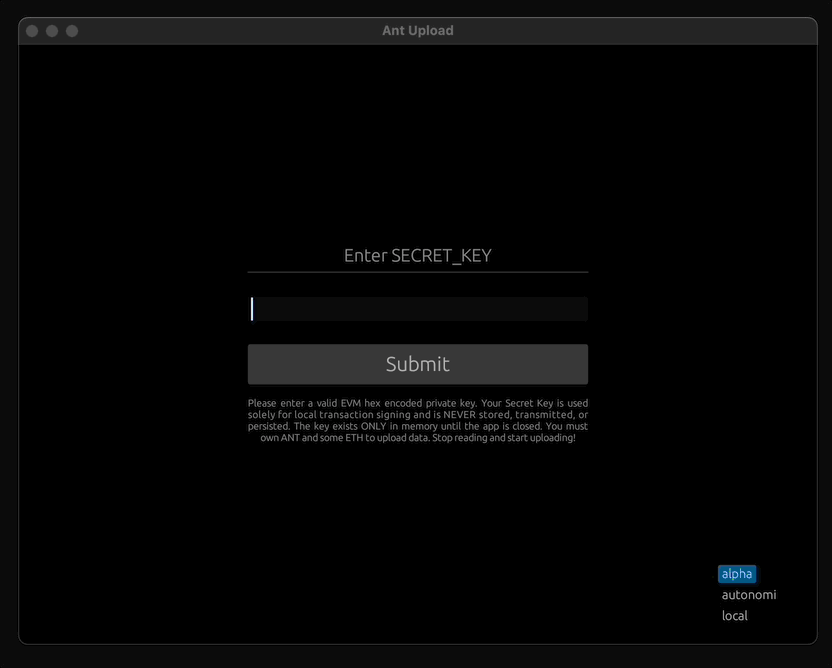

# Ant Upload

Share your files with the world — one drag and drop to eternal access.

Censorship-proof, universally available, and free for everyone.

Pay once to upload — downloads stay free forever.

Liberate the world's knowledge — give it back to everyone



## Download it

[Download the latest release on github with a click!](https://github.com/grumbach/ant_upload/releases/latest) 

Or download directly from the Autonomi Network:

```bash
# macOS aarch64
ant file download 754c57e0c26fcec399959f73468acf13d789eac4d675696bf6ec2a11d3d0c095 AntUpload-aarch64-apple-darwin.zip

# Linux aarch64
ant file download 9b66df59f4b16f5e179457a83a1913a74a784f0caf6bb678d837a90c5b76b86e AntUpload-aarch64-unknown-linux-musl.zip

# macOS x86_64 
ant file download 3d1d60be275a8f08de757b28b5624fc80221f40fd0d57baf49b23e4b0a693146 AntUpload-x86_64-apple-darwin.zip

# Linux x86_64
ant file download 946c3f48c6a1ac16f002dfdc0a526f4924fd57002980bb61c7003c05d3b7b50f AntUpload-x86_64-unknown-linux-musl.zip
```

*AntUpload was uploaded to the Network using AntUpload!*

> Mac users might face quarantine issues: `"AntUpload.app" is damaged and can't be opened. You should move it to the Trash.`
>
> This happens because I don't have a $99 a year Apple Developer account :(
>
> To fix this:
> 1. **Unzip** the file (double-click the `.zip`).
> 2. Open **Terminal** (press `Cmd + Space`, type "Terminal", and press Enter).
> 3. Go to your Downloads folder:
>   ```bash
>   cd ~/Downloads
>   ```
> 4. Remove macOS quarantine flag:
>   ```bash
>   xattr -rd com.apple.quarantine AntUpload.app
>   ```
> 5. Double-click **AntUpload.app** to open it!

## Build it from source

```bash
# currently uses the bleeding edge of the autonomi API which will eventually be released but for avant-garde users here's a how to guide

# clone the autonomi repo and use the make_missing_file_upload_api_stream branch
git clone https://github.com/grumbach/autonomi.git 
cd autonomi
git fetch origin make_missing_file_upload_api_stream 
git checkout make_missing_file_upload_api_stream

# go back into the ant-upload directory
cd ..

# build the release version of the app
cargo build --release

# (for macOS) make a AntUpload.app
bash ./assets/mac_os_bundle.sh
```

## Run it from source

```bash
cargo run --release
```

## For those diving into the code

- The `src/server.rs` file contains the main logic for all autonomi network interaction
- The `src/main.rs` 90% AI vibe-coded front-end for the app
- The `src/cached_payments.rs` file is copy pasted as is from the ant CLI, it allows re-use of payments for retries (which means it's cross compatible with ant CLI)

## Coming soon

- Use the public Autonomi API release instead of the bleeding edge make_missing_file_upload_api_stream branch
- Windows binary releases (need help here)
- Download files from the Autonomi Network
- A repository of all shared files
- Suggest more features by submitting or upvoting an issue on github
